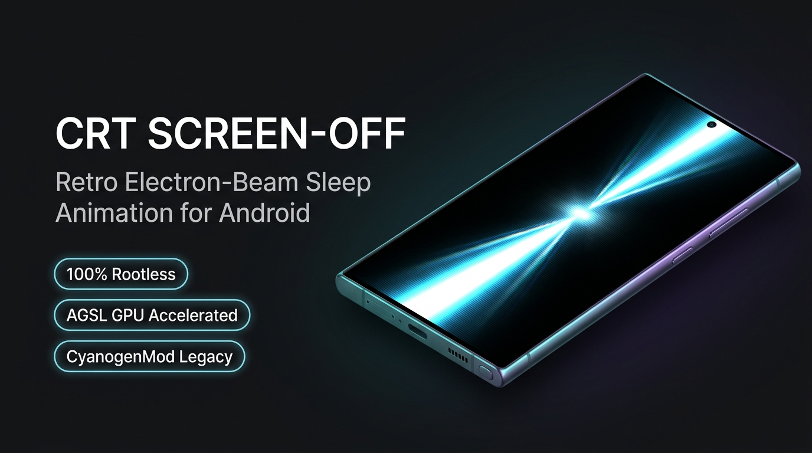

<p align="center">
  
</p>

# CRT Screen-Off Animation

<p align="center">
  <strong>CyanogenMod-Inspired Retro Electron-Beam Sleep Animation Engine for Modern Android (Android 13–16+)</strong>
</p>

<p align="center">
  
  
  
  
  
</p>

---

## 📺 Project Heritage & Lineage

Back in the golden era of Android (**Android 2.3 Gingerbread through 4.0 Ice Cream Sandwich**), Google and the legendary **CyanogenMod community (CM7 / CM9)** introduced the iconic CRT screen-off animation, handled natively in C++ inside Android's display compositor SurfaceFlinger (`ElectronBeam.cpp`).

As deflection coils collapsed the vertical sweep, the electron beam density flared into a searing horizontal razor line before vanishing into pure cathode darkness. When newer Android releases retired this native effect, achieving it historically required device rooting, custom ROMs, or invasive framework-hooking tools that tripped Knox hardware fuses and broke SafetyNet / Play Integrity.

**CRT Screen-Off Animation** revives that beloved retro electron-beam experience completely **rootless on Android 13 through Android 16+**, combining official Android Accessibility APIs with high-performance, hardware-accelerated **AGSL (Android Graphics Shading Language)** rendering.

---

## ✨ Key Features

- **⚡ 100% Rootless & Knox Safe:** Zero root, zero Magisk, and zero framework modification required. Knox fuses and Play Integrity remain untouched.
- **🎨 Dual Physics Animation Engines:**
  - **CyanogenMod Retro Engine:** Inspired by the classic CM7/CM9 `ElectronBeam` sweep with dynamic vertical squish, true-color prism split, delayed crescendo flare, and clean horizontal beam zip.
  - **Phosphor Overdrive Engine:** Simulates vintage CRT cathode tubes with customizable phosphor persistence (Green P1, Amber P3, Blue P4, White P4, Cyan), chromatic aberration, raster scanlines, and discharge flicker.
- **🚀 120Hz Hardware Acceleration:** Powered by native Android AGSL shaders running directly on the GPU for zero-stutter 120Hz deflection.
- **🔋 Zero Idle Battery Impact:** No persistent foreground service, background wake locks, or polling loops. The engine is completely dormant until invoked.
- **👆 One-Tap & Gesture Triggers:**
  - Dedicated zero-flicker headless trigger (`LockTriggerActivity`).
  - Home screen shortcuts & launcher icons.
  - Native integration with **Samsung Good Lock (One Hand Operation+)** for edge-swipe CRT screen-off gestures.
  - Headless broadcast receiver (`com.typongtv.crtscreenoff.TRIGGER_LOCK`) for automation tools (Tasker, Macrodroid, ADB).

---

## ⚙️ How It Works

1. **Trigger:** You tap the **CRT Lock** shortcut, trigger a gesture via Samsung One Hand Operation+, or fire the broadcast.
2. **Instant Capture:** The lightweight `CrtAccessibilityService` captures the top-level screen frame entirely in-memory using Android's official `takeScreenshot` API.
3. **GPU Deflection:** An overlay window renders the collapsing frame through AGSL fragment shaders, reproducing electromagnetic deflection, chromatic aberration, and phosphor burn-in fade.
4. **Hardware Sleep:** Once the cathode flare collapses into darkness, the service calls `GLOBAL_ACTION_LOCK_SCREEN` to put the display to sleep cleanly.

---

## 🔒 Security & Privacy Transparency

Because this app utilizes Android's **Accessibility Service** API, complete transparency is paramount:

* **🚫 NO INTERNET PERMISSION:** The application does **not** declare `android.permission.INTERNET` in its manifest. It is physically impossible for the app to send data off your device.
* **🔒 Ephemeral In-Memory Frame:** The screen capture is only held in volatile memory for the duration of the 300–400ms animation and is immediately recycled.
* **🛡️ Zero Telemetry / Zero Tracking:** No analytics libraries, third-party SDKs, or background trackers are included.

---

## 🛠️ Building From Source

### Prerequisites
- Android Studio Hedgehog (2023.1.1) or newer
- JDK 17
- Android SDK 36 (targetSdk 36, minSdk 33)

### Build Commands
```bash
# Clone the repository
git clone https://github.com/Typongtv/CRT-Screen-Off-Animation.git
cd CRT-Screen-Off-Animation

# Build debug APK
./gradlew assembleDebug

# Build release APK
./gradlew assembleRelease
```
The compiled APK will be output to:
`app/build/outputs/apk/release/`

---

## 📄 License

**Copyright (c) 2026 Typongtv. All Rights Reserved.**

This repository and its source code are made publicly available for viewing, educational purposes, and personal security inspection only. Unauthorized copying, modification, distribution, redistribution, or publishing of this software, in source or binary form, is strictly prohibited without prior written permission from the copyright holder.
